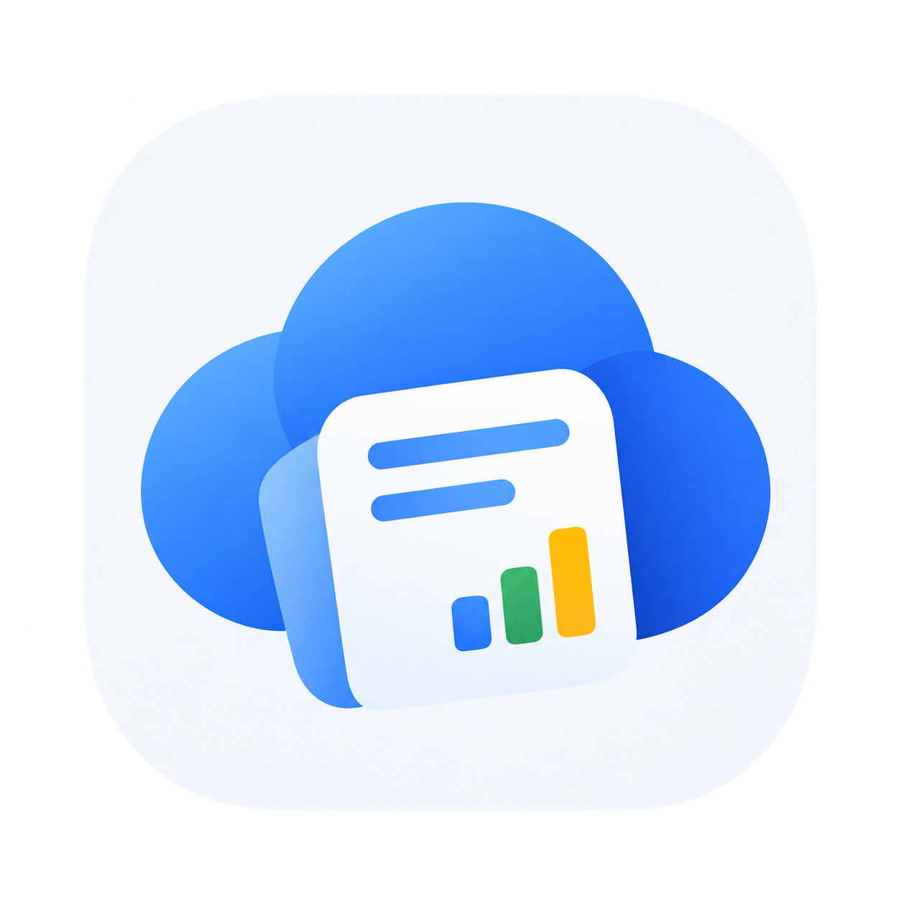
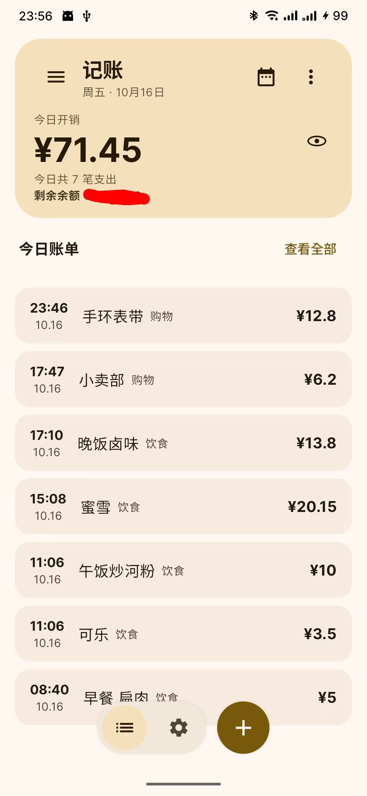

<p align="center">
  
</p>

<h1 align="center">CloudLedger · 云账</h1>

<p align="center">
  一个把账本写在 Markdown 里、扔在 WebDAV 上的记账 App。<br/>
  没有账号系统,没有会员订阅,没有开屏广告 —— 数据是你自己的,丢了也是你自己的。
</p>

<p align="center">
  
</p>

## 这是什么

市面上记账 App 的通病:账本锁在别人的数据库里,想导出来比把钱赚回来还难。

CloudLedger 反着来:你的账本就是一个 `expenses.md`,躺在**你自己的** WebDAV 服务器上。Obsidian 打开就能看,想改就改(最好别乱改)。

App 只负责三件事:**记、看、同步**。剩下的花活,全靠服务器上一个 AI 工具在背后默默打工(见下文)。

## 功能

- **记一笔**:支出/收入、日期、时间,三秒记完。断网?先存本地,联网自动补传,一笔都不会少(认真的)
- **仪表盘**:今日开销大数字,大到无法直视,理论上能抑制消费冲动(并不能)
- **分类小字**:描述旁边的分类标签 —— 不是你标的,是服务器上那个 AI 熬夜标的
- **剩余余额**:来自 AI 月度报告。数字的准确性由 AI 担保,本 App 概不负责
- **长按改账**:记错了?长按,改,删,就当没发生过
- **月度概览**:本月花了多少、哪天最败家,一目了然
- **Material You**:界面颜色跟你壁纸走。丑了别怪我,怪壁纸

## 工作原理

```
手机 App ──── 追加一行 ────> WebDAV 上的 expenses.md
    │                              │
    │                              ↓ 服务器端 AI 分类工具
    │                         monthly/2026-10.md
    │        (分类、余额、月度报告、甚至 mermaid 饼图)
    │                              │
    └────────── 读回分类和剩余余额 ←─┘
```

记账行长这样,纯文本,Obsidian 里直接敲也行:

```
2026-10-16 17:10 晚饭卤味 cny13.8
```

收入带个 `+`,就这么点学问:

```
2026-10-09 中彩 +cny200
```

## 服务端(目前不公开,别问)

完整体验需要配合服务端:它定时扫描 `expenses.md`,把新流水喂给 AI 分类,生成月度报告。

**它在哪?** 在我的服务器上跑着。
**开源吗?** 目前不公开 —— 不是藏着掖着,就是懒得公开。等哪天整理到不丢人的程度再说。

没有它 App 照样转:记账、同步、编辑、删除全部正常,只是分类小字和剩余余额会罢工。

## 自己编译

- JDK 17(别问 21 行不行,问就是 17 稳)
- Android SDK 37
- `./gradlew installDebug`

第一次打开,去设置页填三样:WebDAV 地址、账号密码、账单文件路径。没有默认值,一个都没有 —— 主打一个高自由度(其实是全删了)。

## 技术栈

Kotlin · Jetpack Compose (Material 3) · OkHttp · 一个 Markdown 文件 · 一点点倔强

---

*如果这个项目让你笑了一下,那就够了。如果还让你省了一笔钱,那属于意外收获。*
